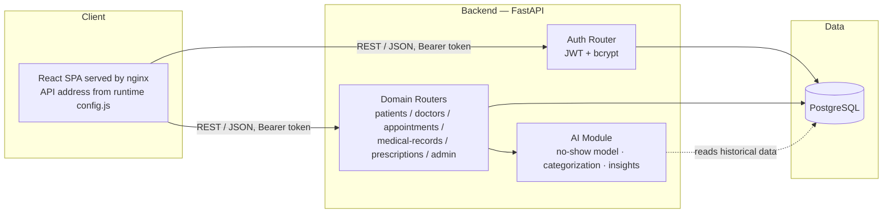
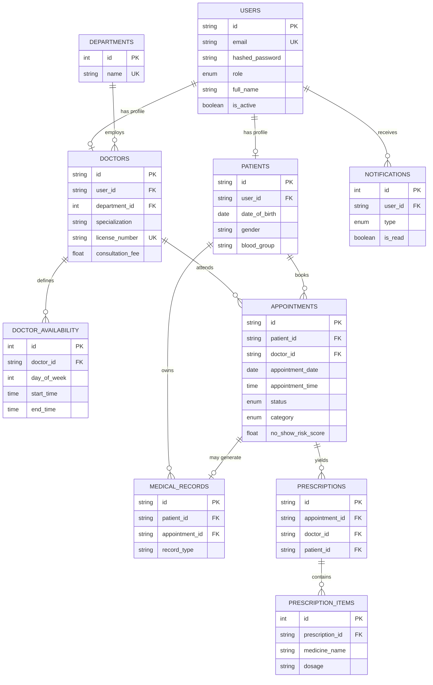
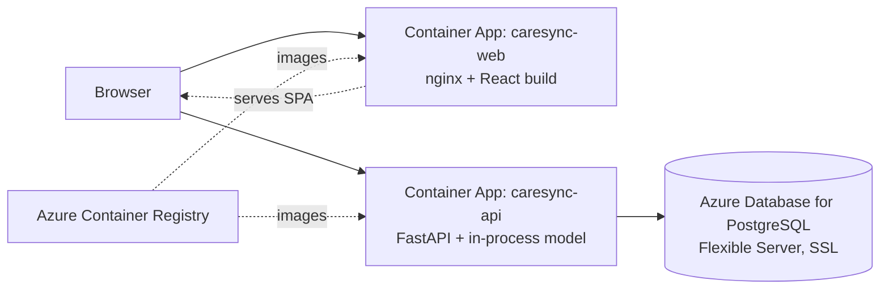

# CareSync — Architecture

## System architecture

The frontend never talks to PostgreSQL directly — every read/write goes
through the FastAPI layer, which enforces role-based access control and
input validation before touching the database.

## Database ER diagram

## Relationship explanation

- **users → patients / doctors** (1:1): `users` is the single identity and
  auth table for every role. A patient or doctor account is a `users` row
  plus a matching profile row holding role-specific fields. Admins have a
  `users` row only.
- **departments → doctors** (1:N): a department groups doctors by
  specialty area for filtering and dashboard rollups; `department_id` is
  nullable so a doctor can exist before being assigned one.
- **doctors → doctor_availability** (1:N): each row is a recurring weekly
  block (day of week + time range + slot length) the booking engine
  expands into concrete open slots for a given date.
- **patients / doctors → appointments** (1:N each): the transactional
  center of the schema. A unique constraint on
  `(doctor_id, appointment_date, appointment_time)` prevents double-booking
  at the database level, not just in application code.
- **appointments → prescriptions → prescription_items** (1:N, 1:N): a
  prescription belongs to exactly one appointment; each prescription can
  list multiple medicines.
- **patients → medical_records** (1:N), optionally linked back to the
  appointment that generated them.
- **users → notifications** (1:N): in-app notifications for booking,
  status changes, and new prescriptions.

## Why these choices

- **UUID string primary keys** on the high-write, externally-referenced
  tables (`users`, `patients`, `doctors`, `appointments`, `medical_records`,
  `prescriptions`) avoid leaking sequential record counts through the API
  and make client-side optimistic IDs straightforward. Lookup/child tables
  (`departments`, `doctor_availability`, `prescription_items`,
  `notifications`) use plain auto-incrementing integers since they're
  never referenced outside the backend.
- **Enums at the database level** (`appointment_status`, `user_role`, ...)
  keep invalid states from ever reaching the database, on top of Pydantic
  validation at the API boundary.
- **The no-show risk score lives on the appointment row**, not in a
  separate predictions table, because it's a point-in-time estimate tied
  to one appointment, not a record that needs its own history.

## Deployment topology (Azure)

* Images are built in Azure (`az acr build`) from `backend/` and `frontend/`.
* `API_URL` is injected into the web container at start; `ALLOWED_ORIGINS` on the API is set to the web app's URL.
* Secrets (database URL, JWT key, seed passwords) are Container Apps secrets referenced by name, never baked into images.
